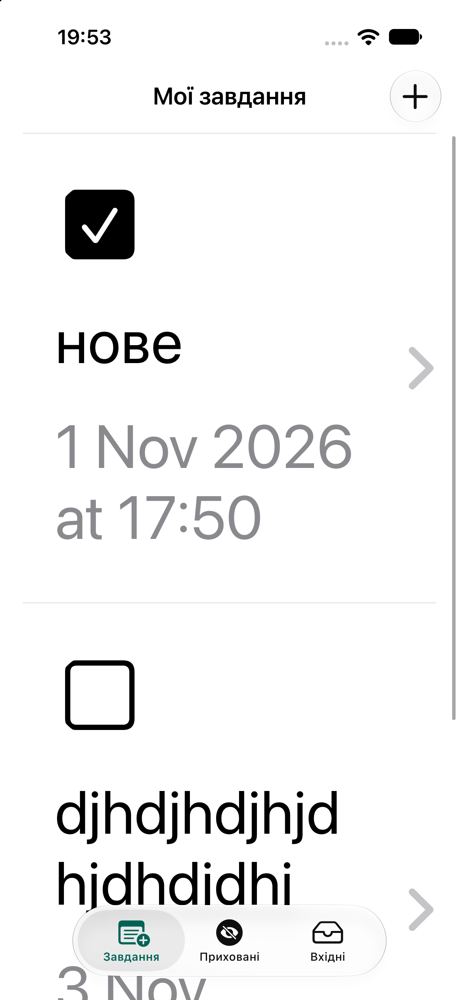
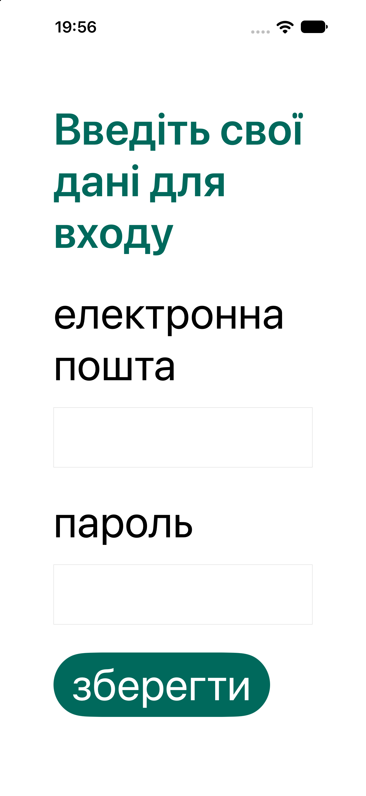
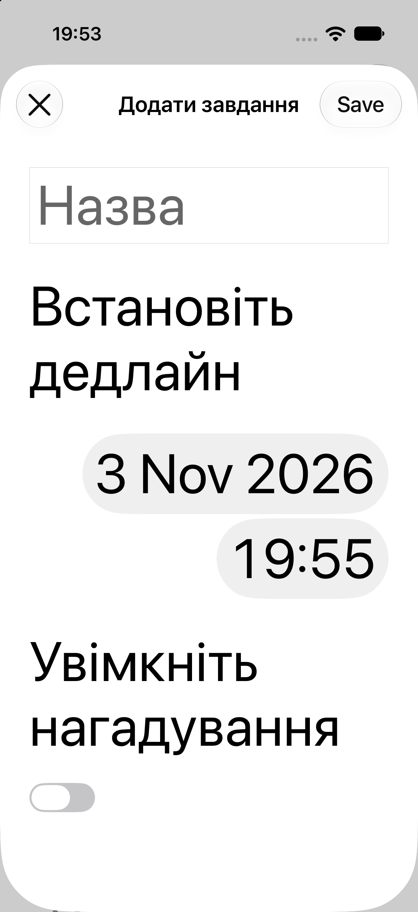
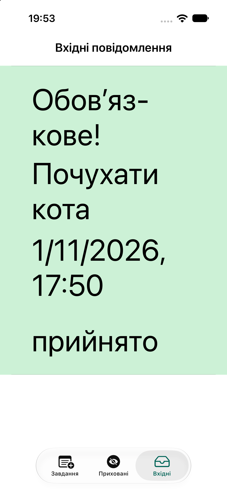
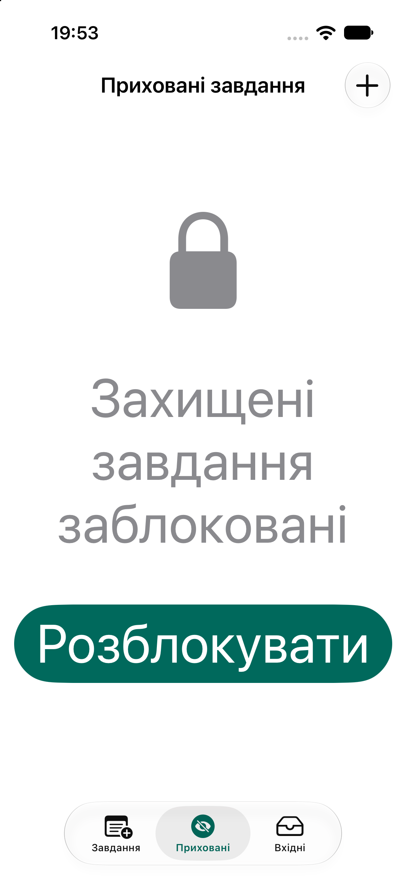

# Доступність ToDo

## 1. Знайдені проблеми та виправлення

### Екран «Мої завдання»

**Було:** назва, дата та кнопка стану сприймалися VoiceOver як окремі елементи; кнопка з SF Symbol могла озвучувати назву символу; не було доступних дій для завершення й видалення; фіксоване горизонтальне компонування не підходило для AX-розмірів.

**Зроблено:** рядок став одним accessibility-елементом із назвою, терміном і наявністю підзавдань; стан винесено в `accessibilityValue`; додано дії «Позначити виконаним/невиконаним» і «Видалити»; внутрішні елементи приховано від VoiceOver. Для AX-категорій стек перебудовується вертикально, текст має необмежену кількість рядків, відступи масштабуються через `UIFontMetrics`. Оновлення й видалення рядків не анімуються за ввімкненого Reduce Motion. Кнопка додавання має українську мітку, зміни стану й видалення оголошуються.

### Екран завдання та список підзавдань

**Було:** підзавдання не передавало VoiceOver повний стан і не мало надійного способу перемкнути завершення або нагадування; заголовок розділу не був позначений як заголовок; компонування не адаптувалося до великих розмірів тексту.

**Зроблено:** рядок підзавдання озвучує назву, термін, виконання і стан сповіщень; додано власні дії для завершення, перемикання сповіщень і видалення. «Список підзавдань» має trait `.header`, кнопка додавання та перемикач нагадування отримали українські мітки. Стек перемикається на вертикальний в AX-категоріях, відступи масштабуються, а табличні анімації вимикаються за Reduce Motion. Зміни стану, сповіщень і видалення оголошуються.

### Екран додавання завдання, підзавдання або захищеного завдання

**Було:** системні кнопки й поля не мали контекстних українських міток; успішне збереження не оголошувалося після закриття модального екрана; форма могла стискатися за великих розмірів тексту.

**Зроблено:** додано контекстні мітки для назви, дати, нагадування, збереження й закриття. Порожня назва та успішне збереження оголошуються через `UIAccessibility.post`. Текст використовує Dynamic Type, стеки перебудовуються для AX-категорій, а відступи масштабуються через `UIFontMetrics`. Поля й перемикач мають мінімальну висоту 44 pt.

### Екран «Вхідні повідомлення»

**Було:** прийняті, відхилені й очікувані сповіщення відрізнялися кольором; рядок не мав цілісного опису для VoiceOver; компонування було фіксованим.

**Зроблено:** статус тепер показується текстом («прийнято», «відхилено», «очікує підтвердження») і передається як `accessibilityValue`, тому колір не є єдиним носієм інформації. Рядок озвучує заголовок, текст і дату. Для AX-категорій стек стає вертикальним, відступи масштабуються. Прийняття або відхилення оголошується через `UIAccessibility.post`.

### Екран «Приховані завдання»

**Було:** заблокований стан і дія розблокування не мали достатнього контексту для VoiceOver; декоративний елемент "замок" озвучувався VoiceOver; розміри зображення та відступів були фіксованими.

**Зроблено:** декоративний замок приховано від VoiceOver, текст заблокованого стану й кнопка розблокування мають українські мітки та підказку про біометричну перевірку.  Зображення, відступи й текст масштабуються; кнопка має щонайменше 44 × 44 pt. Розблоковані рядки мають дії завершення й видалення, а табличні анімації враховують Reduce Motion.

### Екран входу

**Було:** заголовок, поля та кнопка не мали accessibility налаштування; форма використовувала фіксовані проміжки.

**Зроблено:** заголовок має trait `.header`, поля мають мітки «Електронна пошта» і «Пароль», кнопка – «Увійти». Після відкриття фокус переводиться на заголовок; порожні поля оголошуються, а помилка авторизації показується системним `UIAlertController`, на який VoiceOver переводить фокус. Проміжки масштабуються через `UIFontMetrics`, інтерактивні елементи мають мінімальну висоту 44 pt.

### Екран завантаження

**Було:** екран не мав підтримки Dynamic Type та VoiceOver.

**Зроблено:** декоративне зображення приховано від VoiceOver, текст використовує стиль `.headline`, зображення і відступи масштабуються через `UIFontMetrics`, а початок перевірки автентифікації оголошується.

### Загальні виправлення

- У storyboard текст переведено на системні текстові стилі, увімкнено `adjustsFontForContentSizeCategory`, а багаторядковим елементам дозволено переносити текст.
- `AccentColor` і `AccentForeground` мають окремі Light, Dark, High Contrast Light і High Contrast Dark варіанти. 
- Для власних кнопок, перемикачів і кнопок стану додано мінімальні зони дотику 44 × 44 pt.
- Поточні 6 тестів `ScreenAccessibilityUITests` успішно пройшли.

## 2. Accessibility Nutrition Labels

| Можливість App Store | Підтримка | Як перевірено/ Чому не стосується |
|---|---|---|
| VoiceOver | Так | Перевірено статично за `accessibilityLabel`, `accessibilityValue`, traits, custom actions і announcements; Протестовано на власному девайсі повний шлях створення  і перегляд завдання, підзавдання. |
| Voice Control | Частково | Стандартні UIKit-контроли мають зрозумілі українські accessibility-імена й touch targets, але  додаткових альтернативниз міток не було створено.  |
| Larger Text | Так | Усі знайдені тексти використовують text styles і `adjustsFontForContentSizeCategory`; стеки перебудовуються, метрики масштабуються. Пройдено AX5 audit  |
| Dark Interface | Так | Використовуються семантичні системні кольори; власні `AccentColor` та `AccentForeground` мають Dark і High Contrast варіанти. Перевірено в симуляторі на темній темі. |
| Differentiate Without Color Alone | Так | Статус повідомлення у «Вхідних» відображається не лише фоном, а й текстом та `accessibilityValue`.  |
| Sufficient Contrast | Так | Всі кольори перевірено в Color Contrast Calculator Accessibility Inspector. Розраховані пари акцентних кольорів перевищують 4,5:1; системні кольори адаптуються до теми.  |
| Reduced Motion | Так | Для `reloadRows` і `deleteRows` використовується `.none`, коли `UIAccessibility.isReduceMotionEnabled`; решта переходів — системні UIKit-переходи. |
| Captions | Не стосується | Застосунок не містить відео або іншого аудіоконтенту. |
| Audio Descriptions | Не стосується | Застосунок не містить відео чи візуального медіаконтенту. |

## Скриншоти на AX5

| Екран | AX5 |
|---|---|
| Мої завдання |  |
| Вхід |  |
| Додавання завдання |  |
| Вхідні повідомлення |  |
| Приховані завдання|  |

