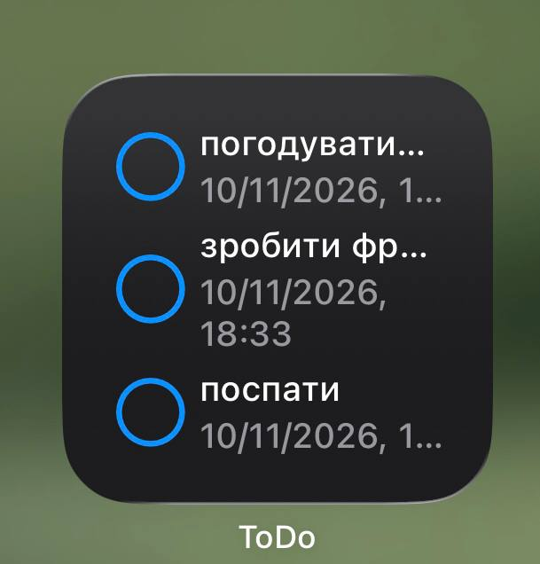
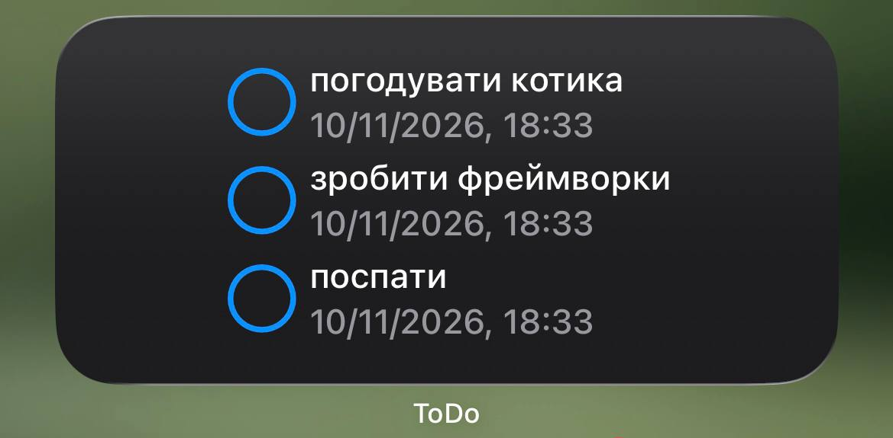
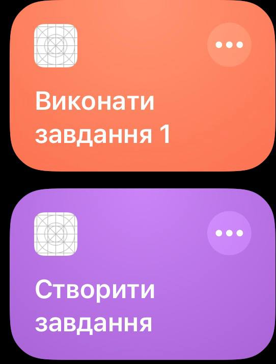

# Розширення застосунку ToDo

## 1. Схема проєкту

У проєкті є чотири цілі:

- `ToDo` — основний iOS-застосунок. Він показує список завдань, дозволяє створювати, видаляти й позначати їх виконаними, керує нагадуваннями та захищеними завданнями.
- `TodoWidgetExtension` — розширення WidgetKit із віджетом «Найближчі справи». Віджет підтримує малий, середній і `accessoryRectangular` формати.
- `ToDoAppIntents` — розширення App Intents для дій у Shortcuts і Spotlight.
- `ToDoUITests` — ціль UI-тестів застосунку.

### Спільний код

Код, який потрібний основному застосунку, віджету та App Intents, розташований у каталозі `Shared`:

- `Shared/Models` — спільні моделі `TodoTask`, `TodoSubtask`, `NotificationTask` та допоміжні типи;
- `Shared/Persistence/PersistenceService.swift` — протокол сервісу бази даних;
- `Shared/Persistence/PersistenceServiceProvider.swift` — спільна точка отримання реалізації сервісу;
- `Shared/Persistence/CoreData` — реалізація `CoreDataService`, Core Data-модель і класи сутностей;
- `Shared/TaskChangeNotifier.swift` — оновлення timeline віджета через `WidgetCenter`.


### Розміщення даних

Основний застосунок, Widget Extension і App Intents Extension мають спільну App Group:

```text
group.ua.edu.ukma.tsisaruk.ToDo
```

Core Data-сховище створюється у контейнері цієї групи через `containerURL(forSecurityApplicationGroupIdentifier:)`. Файл бази даних має назву:

```text
Todo.sqlite
```


## 2. Політика оновлення віджета

`TodoProvider` отримує до чотирьох невиконаних завдань, відсортованих за дедлайном. Для timeline створюється один актуальний `TodoEntry`.

Наступний час оновлення визначається так:

1. Серед завдань знаходиться найближчий майбутній дедлайн.
2. Віджет просить WidgetKit оновити timeline через одну секунду після цього дедлайну.
3. Якщо майбутніх дедлайнів немає, використовується резервне оновлення через 6 хвилин (`6 * 60` секунд у поточній реалізації).

Для timeline використовується політика:

```swift
.after(updateTime)
```

Така політика обрана тому, що без дії користувача вміст віджета має змінитися саме після настання дедлайну: замість дати завдання потрібно показати «Прострочено». Постійно оновлювати віджет із коротким фіксованим інтервалом немає потреби, коли відомий точний момент наступної зміни.

Після створення, видалення або зміни стану завдання застосунок окремо викликає:

```swift
WidgetCenter.shared.reloadTimelines(ofKind: "PendingTasks")
```

## 3. Скриншоти

### 3.1. Віджет малого розміру

Віджет «Найближчі справи» у форматі `systemSmall`:



### 3.2. Віджет середнього розміру

Віджет «Найближчі справи» у форматі `systemMedium`:



### 3.3. Віджет на заблокованому екрані

Віджет у форматі `accessoryRectangular` на заблокованому екрані:


### 3.4. Дії в Shortcuts

Дії App Intents «Виконати завдання» і «Створити завдання» у застосунку Shortcuts:


